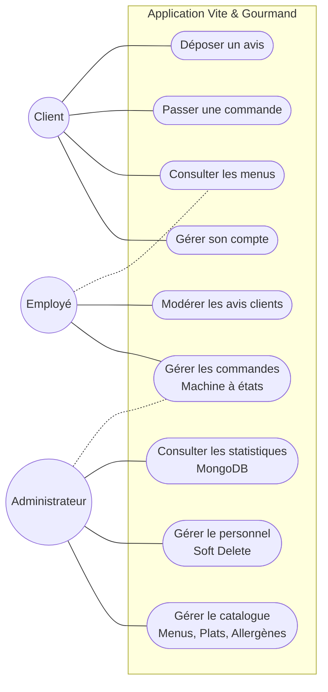
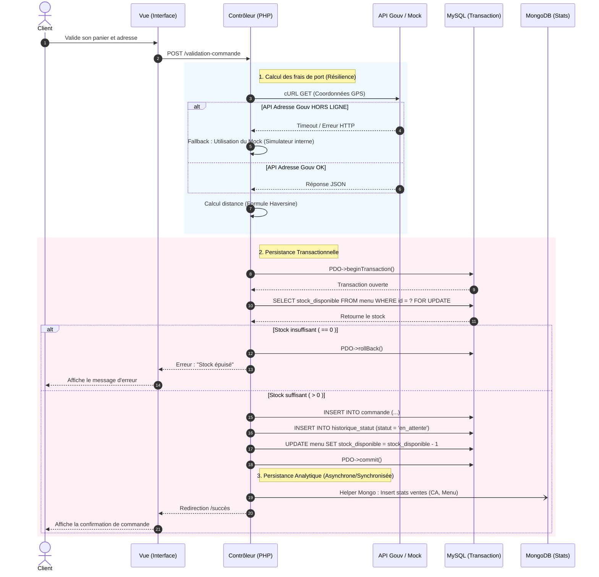

# Diagrammes UML - Vite & Gourmand

## 1. Diagramme de Cas d'Utilisation

Ce diagramme illustre les interactions des différents acteurs (Client, Employé, Administrateur) avec les fonctionnalités du système.

# Diagrammes d'utilisation et de séquence

## 1. Diagramme de séquence : Le tunnel de commande

Ce diagramme illustre la complexité technique du passage d'une commande, incluant l'appel à une API externe (avec résilience), la gestion transactionnelle (MySQL) et la persistance polyglotte (MongoDB).

